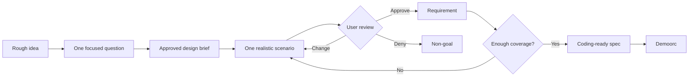

<div align="center">

# Demoview

**Make the product visible before you make it real.**

Demoview turns a rough idea into a coding-ready specification by letting people react to one realistic product scenario at a time.

[![MIT License][license-shield]][license-url]
[![Open Issues][issues-shield]][issues-url]

[Explore the workflow](#how-it-works) · [Install](#installation) · [Report a problem](https://github.com/dulame/Demoview/issues)

</div>

## About the project

Most people do not want to write a complete product specification. They can, however, look at a concrete interaction and say: *yes, no, or change this*.

Demoview is a two-skill workflow for that kind of product design:

- **Demoview** guides discovery, secures approval for a compact design brief, and demonstrates one realistic scenario at a time.
- **Demoorc** turns the approved specification into an implementation plan and routes authorized work by complexity and risk.

The important constraint is simple: generated behavior is not a requirement until the user approves it.

## How it works



Every scenario has a stable ID and one of four states:

| State | Meaning |
| --- | --- |
| Approved | Build this behavior. |
| Changed | Build the corrected version. |
| Denied | Record it as a non-goal. |
| Unreviewed | Keep it exploratory and out of the specification. |

## A small example

```text
User: Use Demoview. I want a Telegram bot for solo teachers.

Assistant: The bot should help one teacher manage lessons and money
without becoming a full school-management system.

First question: when a lesson is marked as attended, should the
student's balance change automatically?

User: Yes.
```

After the brief is approved, Demoview stops asking abstract questions and shows the product as it would actually feel:

```text
S04: Mark attendance

Bot: English A1 · Monday, 17:00-18:00
[Present] [Absent] [Cancel]

Teacher taps: Present

Bot: Attendance saved. A lesson charge was added to Amina's balance.

Decision: approve, deny, or change?
```

## Project structure

```text
demoview/
├── demoview/     # discovery, scenarios, review loop, final specification
└── demoorc/      # implementation planning, routing, and verification
```

Keep both directories together. Their instructions use relative links to move from the approved specification into implementation planning.

## Getting started

### Prerequisites

- An LLM coding environment that supports `SKILL.md` agent skills
- The `brainstorming` skill, required before Demoview generates scenarios
- Optional companion skills such as `ponytail`, `socrates`, `grilling`, `ubiquitous-language`, `spec-driven-development`, and `planning-and-task-breakdown`

Demoorc can route work across models only when the current runtime exposes compatible subagent and model-selection controls.

### Installation

Clone the project:

```bash
git clone https://github.com/dulame/Demoview.git
cd Demoview
```

Copy both skill directories into your runtime's skills directory. For Codex:

```bash
cp -R demoview demoorc ~/.codex/skills/
```

Restart or reload the coding environment so it discovers the skills.

## Usage

Start from the product idea, not from implementation details:

```text
Use Demoview: help me design a Telegram bot that tracks attendance,
lesson payments, and class schedules for solo online teachers.
```

Demoview will:

1. Ask one focused planning question at a time.
2. Propose a compact design brief for approval.
3. Demonstrate one scenario at a time using realistic screens, messages, controls, or commands.
4. Record each scenario as approved, changed, denied, or unreviewed.
5. Produce a coding-ready specification whose requirements trace back to reviewed scenarios.

When the specification is approved, request planning or implementation explicitly:

```text
Use Demoorc to plan the approved Demoview specification.
```

Planning does not automatically authorize implementation, deployment, migrations, or deletion.

## Design principles

- **One decision at a time.** No wall of generated scenarios.
- **Demonstrate the interface.** Show real messages, buttons, screens, commands, or responses.
- **Approval is evidence.** Only approved or changed scenarios become requirements.
- **Rejection is useful.** Denied scenarios remain visible as non-goals.
- **Scope before polish.** Ponytail can reduce speculative scope before the design brief is approved.
- **Traceability over confidence.** A requirement without an approved source scenario does not belong in the spec.

## Contributing

Issues and focused pull requests are welcome. Changes to the workflow should include a pressure or regression case under the relevant `tests/` directory, showing the behavior the skill is intended to enforce.

1. Fork the repository.
2. Create a short-lived branch.
3. Change one behavior or documentation concern.
4. Add or update its regression case.
5. Open a pull request explaining the product-design problem being solved.

## License

Distributed under the MIT License. See [`LICENSE`](LICENSE) for details.

## Acknowledgments

README structure adapted from [Best README Template](https://github.com/othneildrew/Best-README-Template).

Project: [github.com/dulame/Demoview](https://github.com/dulame/Demoview)

[license-shield]: https://img.shields.io/github/license/dulame/Demoview.svg?style=flat-square
[license-url]: https://github.com/dulame/Demoview/blob/main/LICENSE
[issues-shield]: https://img.shields.io/github/issues/dulame/Demoview.svg?style=flat-square
[issues-url]: https://github.com/dulame/Demoview/issues
